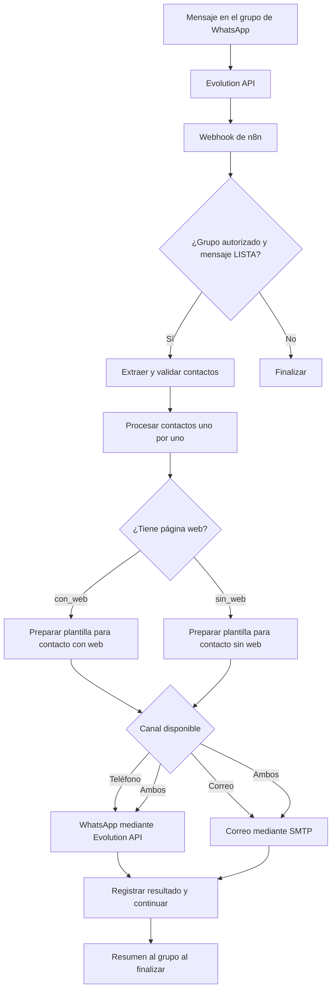

# Flujo de contacto a clientes · Quiel Studio

Automatización en **n8n** para procesar listas de contactos recibidas en un grupo de WhatsApp y enviar mensajes comerciales personalizados por **WhatsApp**, **correo electrónico** o ambos canales.

El flujo distingue entre contactos **con página web** y **sin página web**, prepara el mensaje y el asunto correspondientes y genera un resumen de los envíos.

Incluye el **workflow real exportado de n8n**, una configuración de Docker Compose para una instalación nueva y pruebas locales del procesamiento de listas. El export procede del respaldo usado para migrar a Windows el **12 de noviembre de 2026**; los cambios posteriores realizados en la mini PC pueden no estar incluidos.

Las credenciales se han eliminado del export. El grupo de WhatsApp y el remitente se sustituyeron por valores de ejemplo. El flujo se importa inactivo y necesita configuración antes de publicar.

## Archivos del proyecto

```text
workflows/quielstudio-contactos.json  Flujo importable con sus nodos y conexiones
compose.yaml                        n8n, Evolution API, PostgreSQL y Redis
.env.example                        Variables de ejemplo, sin claves reales
examples/lista-contactos.txt         Lista de ejemplo
tests/workflow.test.mjs              Pruebas locales sin envíos
.gitignore                          Exclusión de credenciales, sesiones y respaldos
```

## Instalación nueva con Docker

Si ya tienes el flujo funcionando en tu mini PC, conserva esa instalación. Este Compose crea volúmenes nuevos y no restaura tus usuarios, credenciales ni sesiones existentes. Tampoco debes levantar otra copia de la misma sesión de WhatsApp mientras la anterior está funcionando.

1. Clona el repositorio:

   ```bash
   git clone https://github.com/ablanco58/flujo-de-contacto-clientes-.git
   cd flujo-de-contacto-clientes-
   ```

2. Copia `.env.example` como `.env`. En PowerShell:

   ```powershell
   Copy-Item .env.example .env
   ```

   En Linux o macOS:

   ```bash
   cp .env.example .env
   ```

3. Edita `.env` y reemplaza los tres valores de ejemplo por claves aleatorias diferentes. Puedes generar cada clave en PowerShell con:

   ```powershell
   [guid]::NewGuid().ToString('N') + [guid]::NewGuid().ToString('N')
   ```

   Conserva la clave `N8N_ENCRYPTION_KEY` después de empezar a guardar credenciales. Para `POSTGRES_PASSWORD`, utiliza una cadena de letras y números: se incorpora a una URI de conexión.

4. Comprueba la configuración y arranca los servicios:

   ```bash
   docker compose config --quiet
   docker compose up -d
   docker compose ps
   ```

5. Abre n8n en `http://localhost:5678` y crea tu cuenta inicial. Abre Evolution Manager en `http://localhost:8080/manager`; usa `http://localhost:8080` como Server URL y el valor que hayas configurado para `AUTHENTICATION_API_KEY`.
6. Crea o vincula la instancia de WhatsApp `bot`, importa el workflow y sigue la configuración de abajo.

Los paneles solo se publican en localhost del equipo. Los puertos del host pueden cambiarse en `.env` si ya están ocupados; la comunicación interna entre contenedores sigue usando `n8n:5678` y `evolution_api:8080`.

## Cómo funciona



## Componentes

| Servicio | Función |
| --- | --- |
| n8n | Recibe el webhook, procesa los contactos y coordina los envíos. |
| Evolution API | Mantiene la conexión con WhatsApp y entrega los eventos a n8n. |
| PostgreSQL | Almacena los datos de Evolution API. |
| Redis | Proporciona la caché configurada para Evolution API. |
| Servidor SMTP | Envía los correos desde la cuenta configurada. |

La instalación de referencia utiliza **n8n 2.46.7**, **Evolution API 2.3.7**, **PostgreSQL 15** y **Redis 7**, ejecutados en Docker. n8n conserva sus propios datos en un volumen persistente con SQLite.

En Windows 11, Docker Desktop debe ejecutar **contenedores Linux**. Los contenedores de n8n y Evolution API deben compartir una red de Docker para comunicarse por sus nombres.

## Formato de las listas

Envía un mensaje que comience por `LISTA` en el grupo autorizado:

```text
LISTA
con_web
Negocio de ejemplo,50760000000,contacto@example.com
Otro negocio,,correo@example.com
sin_web
Negocio sin web,50760000001,
```

- `con_web` y `sin_web` establecen el tipo de los contactos que aparecen debajo, hasta la siguiente sección.
- Cada contacto ocupa una línea con tres columnas: `nombre,teléfono,email`.
- Mantén las comas cuando una columna esté vacía.
- Escribe el teléfono con código de país y solo dígitos.
- Con teléfono y correo válidos, el contacto puede recibir mensajes por ambos canales.
- Los nombres no deben contener comas: el parser utiliza ese carácter para separar las columnas.

Los números y correos anteriores son ejemplos de formato. Para comprobar los envíos, sustitúyelos por tus propios datos de prueba.

## Configuración del flujo

1. Importa [workflows/quielstudio-contactos.json](workflows/quielstudio-contactos.json) desde el menú **⋯ → Import from File** de n8n.
2. Configura las credenciales SMTP y la credencial de encabezado HTTP de Evolution API. Para Evolution, el encabezado es `apikey` y su valor es la clave de tu instalación.
3. Reemplaza `CONFIGURA_EL_GRUPO@g.us` por el identificador real de tu grupo en los nodos **if: chat LISTA**, **reporte al grupo** y **HTTP Request2**. Revisa también el nombre de la instancia de WhatsApp en las URL de envío; en la instalación de referencia se llama `bot`.
4. Revisa el remitente, las plantillas y los enlaces comerciales de ambas ramas antes de enviar mensajes.
5. Comprueba la configuración de los nodos que preparan y envían el correo:

   | Campo | Configuración |
   | --- | --- |
   | Nombre del campo de mensaje | `mensaje`, sin espacios al final |
   | Nombre del campo de asunto | `asunto`, sin espacios al final |
   | To Email | `{{ $json.email }}` |
   | Subject | `{{ $json.asunto }}` |
   | Email Format | `Text` |
   | Text | `{{ $json.mensaje }}` |

   Usa el modo **Expression** en los campos dinámicos, incluidas las plantillas que contienen `{{ $json.nombre }}`.

   En **Email**, sustituye además `correo@example.com` por el remitente autorizado por tu proveedor SMTP. Las credenciales SMTP y HTTP se crean y seleccionan dentro de n8n; no forman parte de este export.

## Dejar el webhook activo en producción

Publica el flujo en n8n con **Publish / Publicar**. Después configura el webhook de la instancia de Evolution:

| Opción | Valor |
| --- | --- |
| Enabled | Activado |
| URL | `http://n8n:5678/webhook/whatsapp-lista` |
| Webhook by Events | Desactivado |
| Evento | `MESSAGES_UPSERT` |

Esta URL supone que el servicio o alias de Docker se llama `n8n`. Desde Evolution, `localhost` se refiere a su propio contenedor.

La ruta `/webhook-test/whatsapp-lista` se utiliza durante las pruebas del editor. Para la operación continua utiliza `/webhook/whatsapp-lista` y mantén el flujo publicado. No hace falta dejar abierto el navegador ni pulsar **Listen for test event**.

## Operación 24/7

- Mantén encendidos el equipo, Docker, la conexión a internet y la sesión de WhatsApp.
- Configura volúmenes persistentes y una política de reinicio para los contenedores.
- Desactiva la suspensión y la hibernación del equipo anfitrión.
- En Windows, comprueba el inicio de Docker Desktop tras reiniciar. Su opción de inicio al entrar en Windows no garantiza que arranque antes de iniciar sesión.
- Revisa las ejecuciones de producción en **Executions** de n8n.
- Haz una prueba con tu propio correo y teléfono antes de procesar listas reales. Comprueba asunto, personalización, canales y reporte final.
- Mantén una sola instalación conectada a la sesión migrada de WhatsApp para evitar conflictos entre equipos.

## Credenciales y respaldo

El repositorio debe contener únicamente el flujo revisado y su documentación. Antes de compartir un JSON, elimina datos de prueba, identificadores privados y cualquier clave o encabezado de autenticación escrito directamente en los nodos.

No publiques archivos `.env`, configuraciones con contraseñas, bases de datos, volúmenes, sesiones de WhatsApp ni el paquete completo de migración. El archivo `compose.json` generado para migrar esta instalación contiene credenciales y debe permanecer privado.

Para restaurar las credenciales de una instalación de n8n se necesita conservar también su clave de cifrado original. Un JSON de workflow no reemplaza un respaldo completo de la instancia.

## Verificación local

Con Node.js 22 o superior, ejecuta:

```bash
node --test tests/workflow.test.mjs
```

Las pruebas ejecutan el código de extracción del workflow con listas de ejemplo, comprueban ambos tipos de plantilla, los campos del correo y la ausencia de credenciales y grupos privados en el export. No conectan con SMTP ni WhatsApp y no sustituyen una prueba de integración en n8n.

Esta copia conserva la lógica del flujo de origen. Antes de utilizarla con listas reales, revisa también estas limitaciones:

- El nodo de registro distingue el correo buscando `Gmail` en el nombre del nodo anterior, aunque el nodo actual se llama `Email`; la etiqueta del canal en el reporte puede ser incorrecta.
- La salida de contactos inválidos y las salidas de error de los nodos de envío no están conectadas al bucle de resultados. Una lista con errores necesita revisión; el resumen no debe tomarse como una confirmación de todos los envíos.
- La rama **Error Trigger** requiere configurar el workflow de errores correspondiente en n8n para recibir fallos automáticamente.

## Guardar cambios en GitHub

Después de editar el flujo en n8n, descárgalo desde **⋯ → Download** y revisa el archivo antes de reemplazar `workflows/quielstudio-contactos.json`: elimina credenciales, datos fijados de ejecuciones, identificadores privados y valores de autenticación. Ejecuta las pruebas y guarda la nueva versión con Git. Los cambios de n8n no se sincronizan automáticamente con este repositorio.

## Documentación oficial

- [Exportar e importar workflows](https://docs.n8n.io/workflows/export-import/)
- [Guardar y publicar workflows](https://docs.n8n.io/workflows/publish/)
- [Webhooks de n8n](https://docs.n8n.io/integrations/builtin/core-nodes/n8n-nodes-base.webhook/)
- [Clave de cifrado de n8n](https://docs.n8n.io/hosting/configuration/configuration-examples/encryption-key/)
- [Volúmenes persistentes de Docker](https://docs.docker.com/engine/storage/volumes/)
