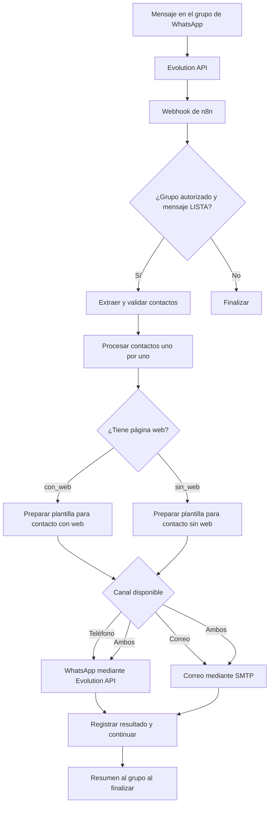

# Flujo de contacto a clientes · Quiel Studio

Automatización en **n8n** para procesar listas de contactos recibidas en un grupo de WhatsApp y enviar mensajes comerciales personalizados por **WhatsApp**, **correo electrónico** o ambos canales.

El flujo distingue entre contactos **con página web** y **sin página web**, prepara el mensaje y el asunto correspondientes y genera un resumen de los envíos.

> Este repositorio documenta el flujo. Para reproducirlo, también se necesita el archivo JSON exportado desde n8n y configurar las credenciales en la instancia de destino. El JSON todavía no está incluido en el repositorio.

## Cómo funciona



## Componentes

| Servicio | Función |
| --- | --- |
| n8n | Recibe el webhook, procesa los contactos y coordina los envíos. |
| Evolution API | Mantiene la conexión con WhatsApp y entrega los eventos a n8n. |
| PostgreSQL | Almacena los datos de Evolution API. |
| Redis | Proporciona la caché configurada para Evolution API. |
| Servidor SMTP | Envía los correos desde la cuenta configurada. |

La instalación de referencia utiliza **n8n 2.46.7**, **Evolution API 2.3.7**, **PostgreSQL 15** y **Redis 7**, ejecutados en Docker. n8n conserva sus propios datos en un volumen persistente con SQLite.

En Windows 11, Docker Desktop debe ejecutar **contenedores Linux**. Los contenedores de n8n y Evolution API deben compartir una red de Docker para comunicarse por sus nombres.

## Formato de las listas

Envía un mensaje que comience por `LISTA` en el grupo autorizado:

```text
LISTA
con_web
Negocio de ejemplo,50760000000,contacto@example.com
Otro negocio,,correo@example.com
sin_web
Negocio sin web,50760000001,
```

- `con_web` y `sin_web` establecen el tipo de los contactos que aparecen debajo, hasta la siguiente sección.
- Cada contacto ocupa una línea con tres columnas: `nombre,teléfono,email`.
- Mantén las comas cuando una columna esté vacía.
- Escribe el teléfono con código de país y solo dígitos.
- Con teléfono y correo válidos, el contacto puede recibir mensajes por ambos canales.
- Los nombres no deben contener comas: el parser utiliza ese carácter para separar las columnas.

Los números y correos anteriores son ejemplos de formato. Para comprobar los envíos, sustitúyelos por tus propios datos de prueba.

## Configuración del flujo

1. Importa el archivo JSON desde el menú **⋯ → Import from File** de n8n, cuando esté disponible.
2. Configura las credenciales SMTP y la credencial de encabezado HTTP de Evolution API. Para Evolution, el encabezado es `apikey` y su valor es la clave de tu instalación.
3. Ajusta el identificador del grupo autorizado y del grupo que recibirá los reportes. Revisa también el nombre de la instancia de WhatsApp; en la instalación de referencia se llama `bot`.
4. Revisa el remitente, las plantillas y los enlaces comerciales de ambas ramas antes de enviar mensajes.
5. Comprueba la configuración de los nodos que preparan y envían el correo:

   | Campo | Configuración |
   | --- | --- |
   | Nombre del campo de mensaje | `mensaje`, sin espacios al final |
   | Nombre del campo de asunto | `asunto`, sin espacios al final |
   | To Email | `{{ $json.email }}` |
   | Subject | `{{ $json.asunto }}` |
   | Email Format | `Text` |
   | Text | `{{ $json.mensaje }}` |

   Usa el modo **Expression** en los campos dinámicos, incluidas las plantillas que contienen `{{ $json.nombre }}`.

## Dejar el webhook activo en producción

Publica el flujo en n8n con **Publish / Publicar**. Después configura el webhook de la instancia de Evolution:

| Opción | Valor |
| --- | --- |
| Enabled | Activado |
| URL | `http://n8n:5678/webhook/whatsapp-lista` |
| Webhook by Events | Desactivado |
| Evento | `MESSAGES_UPSERT` |

Esta URL supone que el servicio o alias de Docker se llama `n8n`. Desde Evolution, `localhost` se refiere a su propio contenedor.

La ruta `/webhook-test/whatsapp-lista` se utiliza durante las pruebas del editor. Para la operación continua utiliza `/webhook/whatsapp-lista` y mantén el flujo publicado. No hace falta dejar abierto el navegador ni pulsar **Listen for test event**.

## Operación 24/7

- Mantén encendidos el equipo, Docker, la conexión a internet y la sesión de WhatsApp.
- Configura volúmenes persistentes y una política de reinicio para los contenedores.
- Desactiva la suspensión y la hibernación del equipo anfitrión.
- En Windows, comprueba el inicio de Docker Desktop tras reiniciar. Su opción de inicio al entrar en Windows no garantiza que arranque antes de iniciar sesión.
- Revisa las ejecuciones de producción en **Executions** de n8n.
- Haz una prueba con tu propio correo y teléfono antes de procesar listas reales. Comprueba asunto, personalización, canales y reporte final.
- Mantén una sola instalación conectada a la sesión migrada de WhatsApp para evitar conflictos entre equipos.

## Credenciales y respaldo

El repositorio debe contener únicamente el flujo revisado y su documentación. Antes de compartir un JSON, elimina datos de prueba, identificadores privados y cualquier clave o encabezado de autenticación escrito directamente en los nodos.

No publiques archivos `.env`, configuraciones con contraseñas, bases de datos, volúmenes, sesiones de WhatsApp ni el paquete completo de migración. El archivo `compose.json` generado para migrar esta instalación contiene credenciales y debe permanecer privado.

Para restaurar las credenciales de una instalación de n8n se necesita conservar también su clave de cifrado original. Un JSON de workflow no reemplaza un respaldo completo de la instancia.

## Documentación oficial

- [Exportar e importar workflows](https://docs.n8n.io/workflows/export-import/)
- [Guardar y publicar workflows](https://docs.n8n.io/workflows/publish/)
- [Webhooks de n8n](https://docs.n8n.io/integrations/builtin/core-nodes/n8n-nodes-base.webhook/)
- [Clave de cifrado de n8n](https://docs.n8n.io/hosting/configuration/configuration-examples/encryption-key/)
- [Volúmenes persistentes de Docker](https://docs.docker.com/engine/storage/volumes/)
